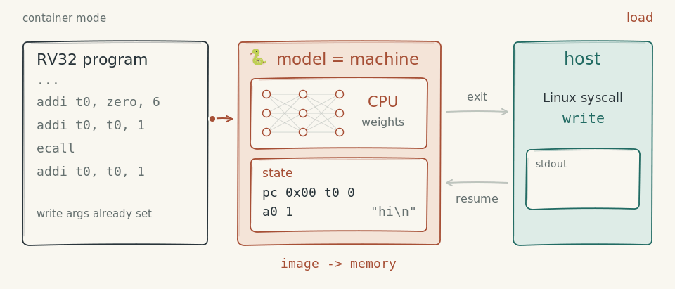
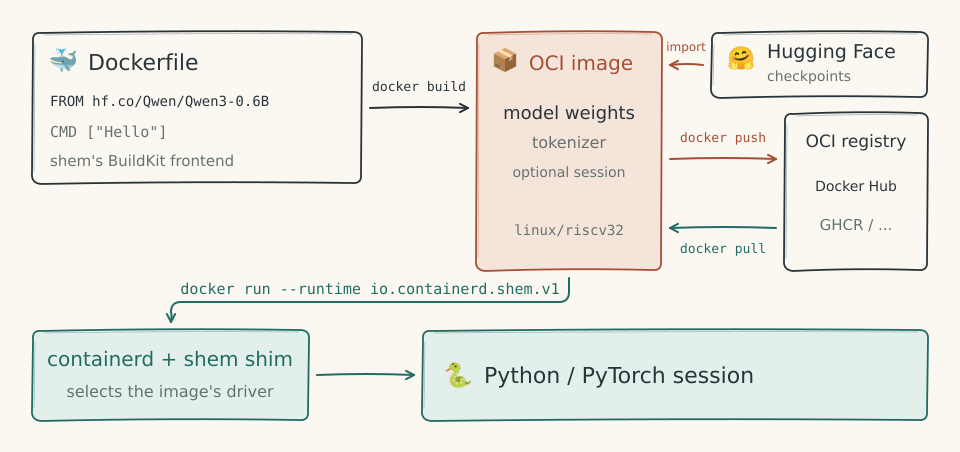
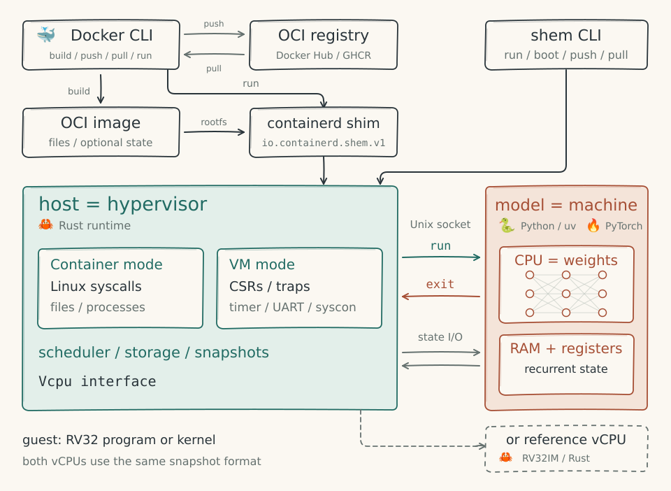

# shem

**Run containers and VMs inside a model's weights.**

[](https://github.com/JGalego/shem/actions/workflows/ci.yml)
[](Cargo.toml)
[](LICENSE)
[](docs/architecture.md#roadmap)

shem treats the host as a hypervisor and a model as the machine. The model supplies a CPU, compiled into its weights, and RAM, which is its recurrent state, as in [Qwenputer](https://divagr.com/blog/qwenputer). The host supplies everything else: system calls, devices, scheduling and storage. [Shemfiles](docs/shemfile.md) build OCI images that can include a frozen process, a booted kernel or a language-model session.

> 📜 **Why shem?** The name comes from the golem legend: a clay figure comes to life when a *shem*, a slip of paper with words on it, is placed in its mouth. Here the weights are the clay and the program is the shem. It's also a fun play on Docker's [containerd shims](https://docs.docker.com/engine/daemon/alternative-runtimes/#use-containerd-shims).



## What works

The project is experimental. Current features include:

- **Model images.** Import Llama, Mistral, Qwen, Gemma, Phi, OLMo, SmolLM, Granite and Mamba checkpoints, and mixtures of experts, from Hugging Face, checkpoint directories or GGUF files (compared with transformers up to Qwen3-30B-A3B and Mixtral-8x7B), run text-generation sessions on a CPU or GPU, serve them as OpenAI's chat completions API, save primed sessions with `WARM`, and publish sessions as artifacts linked to their models. Models can call RV32 programs as tools on a compiled CPU layer ([models](docs/models.md)).
- **Containers.** Run static musl programs and [🧰 BusyBox](https://busybox.net) with a root filesystem, processes, threads, pipes, signals, file mappings and a virtual clock. `shem run` supports host terminals; `--trace` prints system calls.
- **Images.** Build OCI images with `shem build` or the BuildKit frontend. `WARM` saves guest state at build time; `shem run` resumes it. Push and pull images through OCI registries, run [ModelPack](https://github.com/modelpack/model-spec) artifacts as image twins that share their weights' blobs, and publish model images as ModelPack artifacts ([Shemfile](docs/shemfile.md), [models](docs/models.md#modelpack-artifacts)). Keep images in Hugging Face repos with `shem push IMAGE hf.co/ORG/NAME`, run any supported checkpoint with `shem run hf.co/ORG/NAME`, and serve those repos to other OCI clients with `shem registry` ([models](docs/models.md#images-on-hugging-face)).
- **VMs.** Boot no-MMU [🐧 Linux](https://kernel.org) 6.8 with `shem boot`, or resume a booted VM image on either vCPU ([VM mode](docs/vm.md)).
- **[🐳 Docker](https://www.docker.com), [📦 containerd](https://containerd.io) and Kubernetes.** Run images through `io.containerd.shem.v1`, including live model sessions with `docker exec` and `docker commit`, and programs that `docker commit` freezes mid-run, and mount model images as Kubernetes image volumes for model servers ([containerd](docs/containerd.md), [Kubernetes](docs/kubernetes.md)).
- **Neural vCPU.** Execute RV32IM instructions with [🔥 PyTorch](https://pytorch.org), one instruction per forward pass. Tests compare it with the reference interpreter. The server batches compatible guests and shares memory pages; GPU benchmarks use [🤗 Hugging Face Jobs](https://huggingface.co/docs/huggingface_hub/guides/jobs) ([design and benchmarks](docs/neural.md)).
- **Reference vCPU.** A [🦀 Rust](https://www.rust-lang.org) RV32IM interpreter used for differential testing and build-time snapshots. It passes the official riscv-tests, with atomics emulated by the host.

See the [roadmap](docs/architecture.md#roadmap) for what is next.

## Getting started

Install the latest release, with the containerd shim on Linux ([what the script does](install.sh)):

```sh
curl -fsSL https://jgalego.github.io/shem/install.sh | sh
shem run ghcr.io/jgalego/shem/hello:latest
```

To build from source and run a model, you need [🦀 Rust](https://www.rust-lang.org) 1.88 or later and [⚡ uv](https://docs.astral.sh/uv/). This example downloads [Qwen3-0.6B](https://huggingface.co/Qwen/Qwen3-0.6B).

```sh
cargo install --path crates/shem
shem build -t qwen3 examples/qwen3
shem run qwen3 "What is a golem?"
```

To share the image, install [🗄️ ORAS](https://oras.land) and log in to your registry:

```sh
shem push qwen3 ghcr.io/your-user/qwen3:0.6b
```

On another machine with shem installed:

```sh
shem run ghcr.io/your-user/qwen3:0.6b "Say hi in Portuguese"
```

[`examples/qwen3.5`](examples/qwen3.5/Shemfile) builds Qwen3.5-0.8B, whose Gated DeltaNet layers keep a fixed-size memory in place of a growing cache. [`examples/`](examples/README.md) has more: SmolLM2, a Granite mixture of experts, Mamba, Llama from a GGUF file and Gemma, an assistant that reads a handbook at build time, and a model's round trip between ModelPack and shem. [docs/models.md](docs/models.md) explains model images, and the `shem` CLI also runs RV32 programs and Linux ([docs/shemfile.md](docs/shemfile.md), [docs/vm.md](docs/vm.md)).

### With Docker



The [🤗 Qwen3 Dockerfile](examples/qwen3/Dockerfile) uses `FROM hf.co/Qwen/Qwen3-0.6B` and selects shem's BuildKit frontend with its first line:

```dockerfile
# syntax=ghcr.io/jgalego/shem/dockerfile:latest
FROM hf.co/Qwen/Qwen3-0.6B
CMD ["Introduce yourself in one sentence."]
```

Every model example has a Dockerfile too, such as [Qwen3.5](examples/qwen3.5/Dockerfile)'s and a [primed golem session](examples/golem/Dockerfile)'s. [Install the containerd shim](docs/containerd.md#with-docker) and [start the model server](docs/models.md#sessions-under-docker). Replace `your-user` with your registry namespace:

```sh
image=ghcr.io/your-user/qwen3:0.6b
docker build --platform linux/riscv32 -t "$image" examples/qwen3
docker login ghcr.io
docker push "$image"
docker pull --platform linux/riscv32 "$image"
docker run --rm --platform linux/riscv32 \
  --runtime io.containerd.shem.v1 "$image" "What is a golem?"
```

On Docker Desktop, containerd runs in a VM that cannot see the shim, so run the image with shem instead ([Docker Desktop](docs/containerd.md#docker-desktop)):

```sh
docker save "$image" | shem load
shem run "$image" "What is a golem?"
```

For RV32 programs, the [hello Dockerfile](examples/hello/Dockerfile) cross-compiles a static executable and copies it into `FROM scratch`. These use the reference vCPU by default; add `--annotation dev.shem.vcpu=neural` with the [neural vCPU server](docs/neural.md) running to execute on the compiled CPU instead. Language-model images use their session driver, not the vCPU.

### Cleaning up

Remove the images and their unpacked copies.

```sh
rm -rf ~/.local/share/shem
```

Remove the Docker image.

```sh
docker rmi ghcr.io/your-user/qwen3:0.6b
```

Remove the downloaded checkpoint.

```sh
rm -rf ~/.cache/huggingface/hub/models--Qwen--Qwen3-0.6B
```

Uninstall shem.

```sh
cargo uninstall shem
```

Uninstall the containerd shim.

```sh
sudo rm /usr/local/bin/containerd-shim-shem-v1
```

## Compared with ModelPack

[ModelPack](https://github.com/modelpack/model-spec) is a CNCF specification for packaging models as OCI artifacts, implemented by tools such as [KitOps](https://kitops.org), [modctl](https://github.com/modelpack/modctl) and [llmman](https://github.com/llmmanorg/llmman). A ModelPack artifact stores a model for a separate inference server to load; a shem model image is a container image that runs as a model session.

| | ModelPack | shem |
|---|---|---|
| OCI object | An artifact, with `artifactType` `application/vnd.cncf.model.manifest.v1+json` (`vnd.cnai` in artifacts modctl 0.2 builds) | A container image for `linux/riscv32` |
| Weights | The checkpoint's files, unchanged, in any format: safetensors, GGUF, ONNX and others | One safetensors file per block, each in its own layer, imported from Hugging Face (Llama, Mistral, Qwen2 to Qwen3.5, Gemma 2 and 3, Phi-3 and Phi-4-mini, OLMo 2 and 3, SmolLM3, Granite, Mamba, and the mixtures of experts Mixtral, Qwen-MoE, OLMoE and GraniteMoe), local checkpoints or GGUF files. The tensors keep their names and an index finds them, so the directory is also a checkpoint transformers can load |
| Metadata | A model config: name, family, licences, format, precision, parameter count and capabilities | The OCI image config, with `ENTRYPOINT`, `CMD` and `dev.shem.*` labels, and `shem.json`, which lists the blocks the runtime executes |
| Session state | None | An optional layer under `/.shem`, written by `WARM` or `docker commit`, or an artifact of its own whose `subject` is its model (`shem push --state`) |
| Running | Mounted read-only into an inference server, for example as a Kubernetes image volume | Runs as a container: `shem run`, or `docker run --runtime io.containerd.shem.v1`. A ModelPack artifact runs as its image twin |
| Building with Docker | BuildKit rejects the model config type, so an artifact can't be a `FROM` base or a `COPY --from` source | `docker build` builds model images through shem's BuildKit frontend, on ModelPack artifacts too |
| Layer compression | Uncompressed weights recommended | zstd |

shem runs a ModelPack artifact through its [image twin](docs/models.md#modelpack-artifacts): an image over the artifact's own layers, plus a layer with `shem.json`, whose `subject` is the artifact. `shem run` and `FROM` take an artifact like an image. When the artifact's layers are tars, the twin and the artifact share their weights' blobs in a registry. Raw layers, modctl's default, have to be wrapped, and so copied. The other way, `shem push --modelpack` publishes a model image as a ModelPack artifact over the image's own blobs, with the image as its `subject`. Those blobs are compressed with zstd, which modctl 0.2 can't extract; `--uncompressed` writes plain tars, with the files at the root as modctl packs them, which it extracts into a checkpoint that transformers loads.

## Architecture

[](https://github.com/JGalego/shem/blob/main/docs/architecture.md)

## Layout

```
crates/shem/src/
  vcpu.rs        the vCPU interface and the canonical snapshot format
  reference.rs   the reference RV32IM interpreter
  emulate.rs     host emulation of instructions the vCPU lacks (atomics)
  elf.rs         ELF loading and the initial process stack
  linux/         Linux system calls, implemented by the host
    mod.rs       dispatch, per-process state, time and identity
    files.rs     file descriptors, files and directories
    rootfs.rs    path resolution inside the guest's root directory
    signal.rs    signal dispositions, masks and delivery to handlers
    abi.rs       system call numbers, errno values, flags and structs
  mm.rs          the guest address space: heap and anonymous mappings
  container.rs   container mode: processes, the scheduler, fork, exec and wait
  neural.rs      the neural vCPU, as the host reaches it over a socket
  image/         images: Shemfile parser, builder, OCI layouts, the local store, model images
  vm.rs          VM mode: the machine around a guest kernel, and its snapshots
  fdt.rs         device tree writer
  main.rs        the shem CLI
crates/shem/tests/  unit, integration and guest-program tests
crates/containerd-shim-shem/  the containerd shim
fuzz/           fuzz targets for what shem reads from images, with their seeds
frontend/       the BuildKit frontend, in Go, that lets docker build Shemfiles
neural/         the neural vCPU: ISA table, weight compiler, network, executors, server
  src/shem_neural/model/  model images: manifest, block types, importers, tokenizer, the generate driver
  src/shem_neural/hub.py  images in Hugging Face repos, and registry.py, the registry over them
  jobs/gpu.py    GPU differential test and benchmark, for Hugging Face Jobs
space/          the Hugging Face Space that turns checkpoints into images in the user's repos
toolchain/      the guest toolchain image and the riscv-tests environment
guests/         C guest programs
examples/       example Shemfiles and Dockerfiles: models, use cases, programs and VMs
scripts/        development scripts: hadolint for Dockerfiles and Shemfiles
docs/
  architecture.md  design, tech stack and roadmap
  neural.md        how the neural vCPU works, and its protocol
  vm.md            VM mode
  models.md        model images
  containerd.md    the containerd shim
  kubernetes.md    shem in Pods, through a RuntimeClass
  shemfile.md      the Shemfile and the image format
```

## Development

### Stack

- [🦀 Rust](https://www.rust-lang.org) for the host runtime, reference vCPU, CLI and containerd shim ([`crates/`](crates/)).
- [🐍 Python](https://www.python.org) and [🔥 PyTorch](https://pytorch.org) for the neural vCPU and model runtime ([`neural/`](neural/)).
- [⚡ uv](https://docs.astral.sh/uv/) for Python environments and GPU jobs.
- [🐳 Docker](https://www.docker.com) for guest toolchain images and ordinary Shemfile stages ([`toolchain/`](toolchain/)).
- [🦎 Zig](https://ziglang.org) to compile RV32 guest programs against musl.
- [📦 containerd](https://containerd.io) for Docker and Kubernetes integration.
- [🐹 Go](https://go.dev) for the BuildKit frontend ([`frontend/`](frontend/)).

### Set up

Install the git hooks with [pre-commit](https://pre-commit.com). They format and lint on every commit and run the tests before every push.

```sh
pre-commit install --hook-type pre-commit --hook-type pre-push
```

### Check your changes

```sh
cargo fmt --all --check
cargo clippy --workspace --all-targets -- -D warnings
cargo test --workspace
uv run --project neural pytest neural/tests
(cd frontend && go vet ./... && go test ./...)
```

With [cargo-deny](https://github.com/EmbarkStudios/cargo-deny) installed, check dependency licences and advisories:

```sh
cargo deny check
```

[`fuzz/`](fuzz/) fuzzes what shem reads from images, which anyone can make: archives for `shem load`, programs, frozen containers, layers and Shemfiles. With nightly Rust and [cargo-fuzz](https://github.com/rust-fuzz/cargo-fuzz), run each target for a minute:

```sh
just fuzz 60
```

CI runs `just fuzz-ci`, which tries each target's seeds once, the same inputs on every run, so that it fails only for what a change broke. The [fuzz workflow](.github/workflows/fuzz.yml) fuzzes each target for five minutes every day, and keeps the inputs that fail; add them to `fuzz/seeds` with the fix.

The slower suites are ignored tests that need inputs built first: guest programs, BusyBox, the riscv-tests, a Linux kernel, a neural vCPU server, a registry or containerd. CI builds the inputs and runs every suite on each push, and [`.github/workflows/ci.yml`](.github/workflows/ci.yml) shows how. Run one locally with `cargo test --release --test <suite> -- --ignored` once its inputs exist.

### Extend shem

| To add | Change | Test in |
|---|---|---|
| A system call | Its number in [`linux/abi.rs`](crates/shem/src/linux/abi.rs), its dispatch in `Linux::handle` in [`linux/mod.rs`](crates/shem/src/linux/mod.rs), and its implementation on `Process` | [`tests/linux.rs`](crates/shem/tests/linux.rs) |
| A Shemfile instruction | The parser in [`image/shemfile.rs`](crates/shem/src/image/shemfile.rs) and the builder in [`image/build.rs`](crates/shem/src/image/build.rs), then [`docs/shemfile.md`](docs/shemfile.md) | [`tests/image.rs`](crates/shem/tests/image.rs) |
| A device in VM mode | `device_read` and `device_write` in [`vm.rs`](crates/shem/src/vm.rs), and its node in the device tree | [`tests/vm.rs`](crates/shem/tests/vm.rs) |
| An instruction | The reference vCPU in [`reference.rs`](crates/shem/src/reference.rs), the ISA table in [`isa.py`](neural/src/shem_neural/isa.py), and the network in [`cpu.py`](neural/src/shem_neural/cpu.py) | [`tests/reference.rs`](crates/shem/tests/reference.rs), [`neural/tests`](neural/tests/) and [`tests/neural.rs`](crates/shem/tests/neural.rs) |
| A vCPU | The `Vcpu` trait in [`vcpu.rs`](crates/shem/src/vcpu.rs), with snapshots in the canonical format | The differential tests in [`tests/neural.rs`](crates/shem/tests/neural.rs) show how |

### Ground rules

- **The reference vCPU defines correct.** The neural vCPU must match it instruction for instruction, and the dense network and the fused executor must match each other. Tests check both.
- **Runs are deterministic.** Time comes from the virtual clock and randomness from the seeded PRNG. Nothing the guest sees may depend on the host, such as real time, inode numbers or directory order.
- **Docs have no hard wraps.** Each paragraph or list item is one line.
- **Commit messages are one line**, in the form `<type>: <message>`, with a type such as `feat`, `fix`, `docs`, `test`, `ci`, `perf` or `refactor`.

### Release

The [release workflow](.github/workflows/release.yml) publishes Rust crates, the Python package, Linux and macOS binaries, toolchain and example images on GHCR, and [compiled CPU weights](https://huggingface.co/jgalego/shem-rv32im) on Hugging Face. It generates release notes from commit messages and publishes SBOMs and build provenance. CI dry-runs Rust publication and builds the Python package.

Set the same version in [`Cargo.toml`](Cargo.toml) and [`neural/pyproject.toml`](neural/pyproject.toml).

Update the changelog from the commit messages.

```sh
git cliff --tag v0.2.0 -o CHANGELOG.md
```

Commit the release.

```sh
git commit -am "chore: release 0.2.0"
```

Tag the commit and push the tag.

```sh
git tag v0.2.0 && git push origin v0.2.0
```

Before the first release, set up publishing once:

- **crates.io**: add a `CARGO_REGISTRY_TOKEN` secret for the first publish, then configure trusted publishing for both crates (repository `JGalego/shem`, workflow `release.yml`, environment `release`) and delete the secret.
- **PyPI**: add a pending trusted publisher for `shem-neural` (repository `JGalego/shem`, workflow `release.yml`, environment `pypi`).
- **GitHub**: create the `release` and `pypi` environments, with required reviewers if you want to approve each publish.
- **Hugging Face**: create a `huggingface` environment with an `HF_TOKEN` secret, a fine-grained token that can write to `jgalego/shem-rv32im` (or set the `HF_REPO` variable to publish elsewhere).
- **Homebrew** (optional): create the repository `JGalego/homebrew-shem` and a `HOMEBREW_TAP_TOKEN` secret that can push to it; without them the formula is only attached to the release.
- **GitHub Pages**: in the repository's settings, set Pages to deploy from GitHub Actions, and set the repository variable `DOCS_SITE` to `true`, for the docs site.
- **GHCR**: after the first release, make the new packages public (each package's settings, then "Change visibility"): `shem-toolchain`, `shem-neural`, the BuildKit frontend `shem/dockerfile` and the example images under `shem/`.

Install a release's binaries without compiling, with [cargo-binstall](https://github.com/cargo-bins/cargo-binstall) (`cargo binstall shem`) or Homebrew (`brew install jgalego/shem/shem`) on Apple Silicon Macs and on Linux.

### Contribute

Fork the repository, make your change on a branch with its tests and docs, and open a pull request once CI is green. For a change to the design, open an issue first. Sign off your commits (`git commit -s`), as [CONTRIBUTING.md](CONTRIBUTING.md) explains. Contributions are under the [Apache 2.0 license](LICENSE).

## License

[Apache 2.0](LICENSE)
