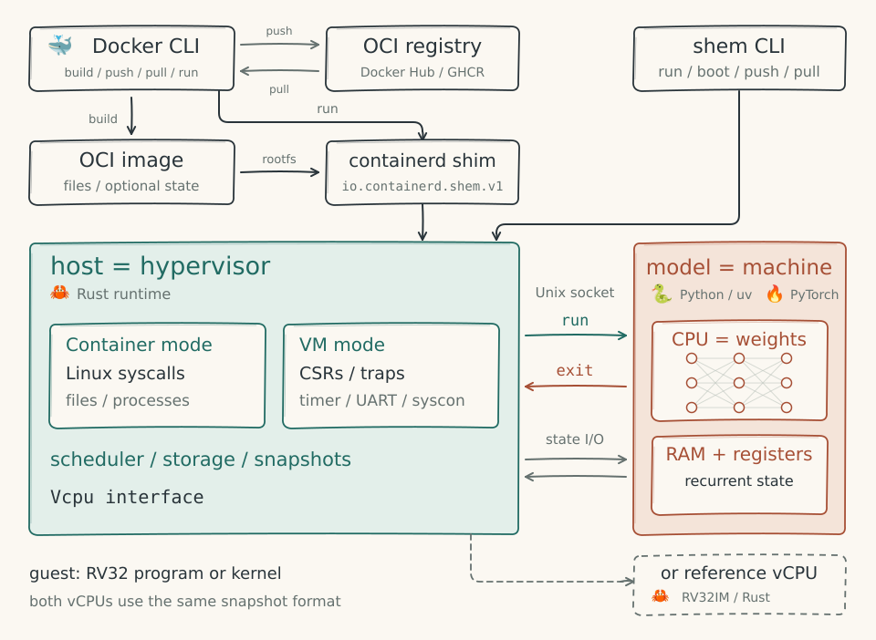

# Architecture

shem's host supplies system calls, devices, scheduling and storage. Programs run on either a reference RV32IM interpreter or a neural vCPU whose weights implement the CPU and whose state holds guest memory.

The neural vCPU is inspired by [Qwenputer](https://divagr.com/blog/qwenputer), but is a standalone compiled network, not part of a pretrained language model. Language-model sessions run separately and can [call RV32 programs as tools](models.md#compiled-layers-and-tools).

## How virtualization maps onto a model

| Virtualization | shem |
|---|---|
| vCPU | Compiled CPU layers |
| Guest RAM | DeltaNet state. A one-hot key writes one row and a one-hot query reads it back. |
| `KVM_RUN` loop | `Vcpu::run` |
| VM exit | The vCPU stops on `ecall`, `ebreak`, an illegal instruction or a memory fault |
| DMA, virtio rings | The host reads and writes state rows directly, without decoding any tokens |
| Timer interrupt | The host stops decoding after a step budget |
| Snapshot | Save canonical machine state and the host-side process or device state |
| Multi-tenancy | The batch dimension |

## Two modes, one runtime

| | Container (`shem run`) | VM (`shem boot`) |
|---|---|---|
| Guest runs | Programs, with the host as their kernel | A kernel and its programs |
| Guest exits on | System calls | Device access, traps, timer ticks |
| Host provides | Linux system calls ([`linux/`](../crates/shem/src/linux/)) | The machine: CSRs, traps, a timer, a UART and a syscon ([vm.md](vm.md)) |
| ISA needed | RV32IM; the host emulates the A extension | RV32IM too; the host emulates A, the CSRs and traps |
| Start | Load an ELF into memory, or thaw a warm image | Boot a kernel, or thaw a booted VM |

## The vCPU interface

[`vcpu.rs`](../crates/shem/src/vcpu.rs) defines the `Vcpu` trait that both the reference interpreter and a neural vCPU implement:

- `run(budget)` executes at most `budget` instructions and returns an `Exit`.
- `reg`, `set_reg`, `pc`, `set_pc`, `read_mem`, `write_mem` access registers and memory.
- `snapshot` and `restore` use `MachineState`, a canonical, vCPU-independent format holding the pc, registers, instruction count and memory.

Exit semantics: except for `Budget`, the exit's `pc` points at the instruction that caused it, and that instruction has not retired. For a system call the host writes the result to `a0` and resumes at `pc + 4`.

Both vCPUs must satisfy:

1. **Trace equivalence.** Registers, memory and exits match [`ReferenceVcpu`](../crates/shem/src/reference.rs) instruction for instruction.
2. **Canonical snapshots.** All state can be restored from `MachineState` at any instruction boundary. A guest can boot on the reference vCPU and resume on the neural one.

## Design rules that come from running on a model

1. **The host handles unsupported operations.** The vCPU exits for system calls, atomics and, in VM mode, privileged instructions and device accesses. [`emulate.rs`](../crates/shem/src/emulate.rs) handles the A extension because musl's riscv32 port needs LR/SC.
2. **Batching supports unrelated guests.** Tensor routing lets one batch run different programs. Throughput and per-guest latency depend on batch size, workload and device ([benchmarks](neural.md#speed)).
3. **Instruction budgets provide preemption.** The host drives execution and stops the vCPU after a bounded number of retired instructions.
4. **`fork()` clones vCPU state.** The reference interpreter copies memory; the neural server shares pages until a write. Threads share their process's vCPU memory and save their registers between turns ([`container.rs`](../crates/shem/src/container.rs)).
5. **The host manages memory backing.** The fused CPU executor uses copy-on-write pages; the dense executor uses delta-rule state, and the GPU harness uses flat byte arrays. This is not a guest MMU.
6. **Builds are reproducible with fixed inputs.** Time is virtual, randomness is seeded, directory listings are sorted, and layer metadata is normalized ([reproducibility](shemfile.md#reproducibility)). Interactive replay also needs the external inputs.

## Isolation

- The only way out of a guest is an exit, so the attack surface is the exit handler. The [system-call layer](../crates/shem/src/linux/) treats every guest pointer and length as hostile: transfers are capped, and bad pointers return `EFAULT`.
- Guest paths resolve inside the root directory with chroot semantics ([`rootfs.rs`](../crates/shem/src/linux/rootfs.rs)): `..` stops at the root, and symlinks, absolute ones included, resolve relative to it. Resolution and the final open are separate host calls, so a concurrent writer to the host directory could race them; a single guest cannot. `openat2` with `RESOLVE_IN_ROOT` would close that gap on Linux hosts.
- Tool calls run on a separate vCPU; the language model does not share its residual stream or state with the compiled CPU.
- Tool output is untrusted model context. Executing a tool on a vCPU does not prevent prompt injection through its output.

## Tech stack

| Part | Implementation |
|---|---|
| Host runtime, CLI, reference vCPU and image store | Rust, in [`crates/shem`](../crates/shem/) |
| Neural vCPU and language-model runtime | Python and PyTorch, in [`neural/`](../neural/). The vCPU server runs on the CPU; the GPU vCPU harness is separate. Model sessions support CPU and GPU execution. |
| Host to neural server | [Framed requests over a Unix socket](neural.md#the-protocol) |
| Images | OCI layouts and registries; ORAS for push and pull |
| Docker, containerd and Kubernetes | [containerd shim](containerd.md) and [RuntimeClass](kubernetes.md) |
| Builds | `shem build` and a Go [BuildKit frontend](shemfile.md#with-docker-build) |
| Guest toolchain | Zig targeting `riscv32-linux-musl`, in [`toolchain/Dockerfile`](../toolchain/Dockerfile) |
| Tests | `cargo test --workspace`, `just guest-tests`, `just neural-tests`, and the integration jobs in [CI](../.github/workflows/ci.yml) |

## Roadmap

See [ROADMAP.md](../ROADMAP.md) for planned work.
