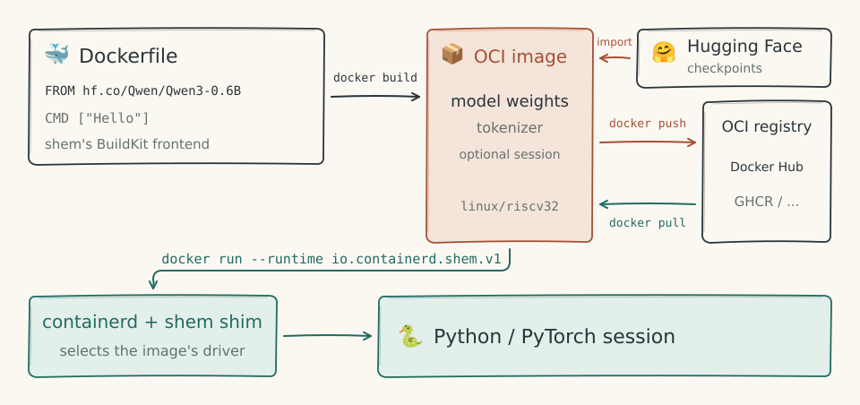
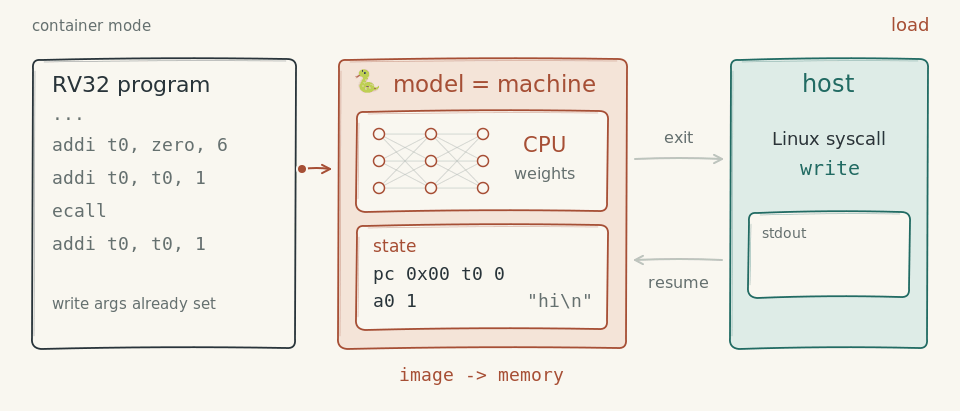
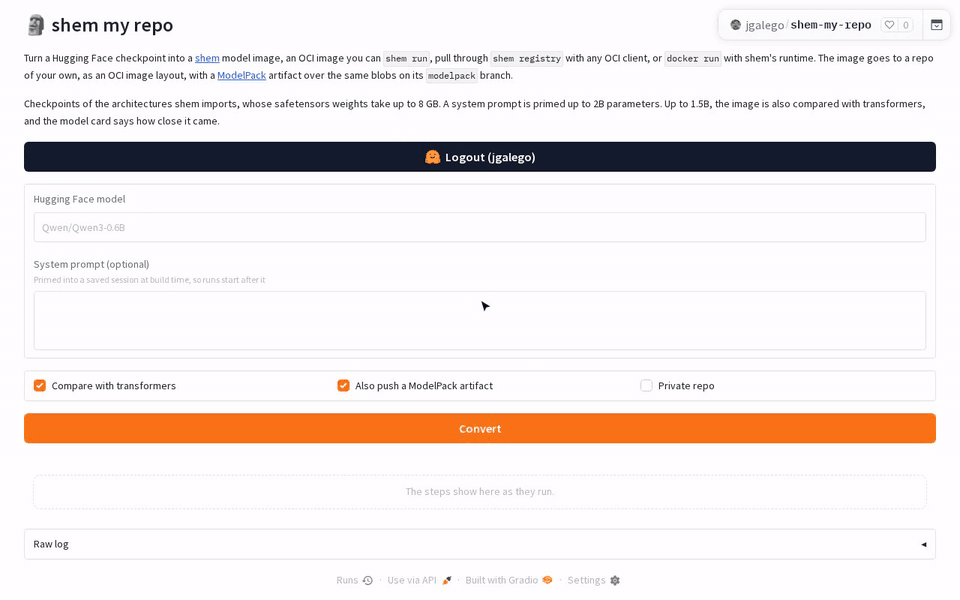
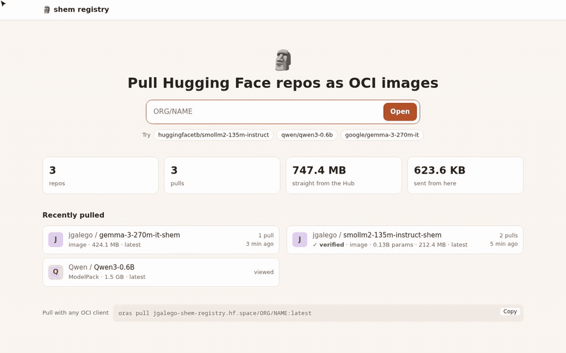
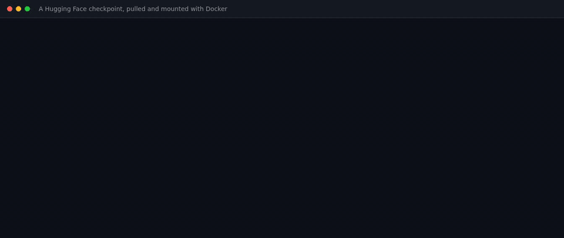
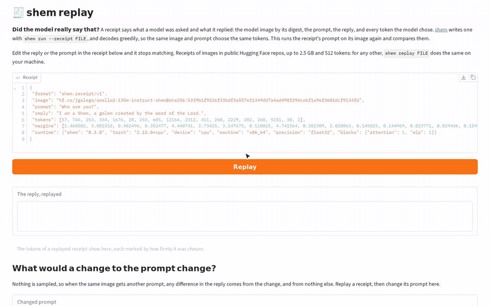

# Your LLM is a container now

> **Updates**
>
> - **2026-11-14**: [Any checkpoint is a Docker image](#🐳-any-checkpoint-is-an-image-now), and [replies come with receipts](#🧾-did-the-model-really-say-that): the registry serves a repo's files as an image Docker pulls and Kubernetes mounts, and a new Space checks what a model replied by running it again.
> - **2026-11-14**: [Hugging Face Spaces](#🤗-the-hub-is-a-registry-now): one turns any supported checkpoint into a shem image in your account, the other serves every repo on the Hub as an OCI registry.
> - **2026-11-13**: [shem 0.2.0](https://github.com/JGalego/shem/releases/tag/v0.2.0) imports many more model families, including mixtures of experts, Mamba and GGUF files. It also pushes and runs [ModelPack](https://github.com/modelpack/model-spec) artifacts, publishes sessions as artifacts linked to their models, and mounts model images as Kubernetes image volumes.

I wanted to find out what happens if you take "it's just a container" much too seriously. So I built [shem](https://github.com/JGalego/shem), a container runtime that does two silly things. It runs language models as containers and it runs containers on a CPU made of model weights.

Both work. Mostly.


*Figure 1: A Dockerfile that starts `FROM hf.co/...`, pushed and pulled like any other image, then run as a model session.*

The name comes from the golem legend: a clay figure wakes up when someone puts a *shem*, a slip of paper with a word on it, into its mouth. The weights are the clay. The program is the word. It's also one vowel away from a containerd *shim*, which is how shem plugs into Docker, and I regret nothing.

**Contents**

- [🚧 Please don't run this in production](#🚧-please-dont-run-this-in-production)
- [📦 Stage 1: A model is just an image](#📦-stage-1-a-model-is-just-an-image)
- [💬 Stage 2: A conversation is just a layer](#💬-stage-2-a-conversation-is-just-a-layer)
- [🧠 Stage 3: The machine is a model too](#🧠-stage-3-the-machine-is-a-model-too)
- [🤔 So why bother?](#🤔-so-why-bother)
- [🤗 The Hub is a registry now](#🤗-the-hub-is-a-registry-now)
- [🐳 Any checkpoint is an image now](#🐳-any-checkpoint-is-an-image-now)
- [🧾 Did the model really say that?](#🧾-did-the-model-really-say-that)
- [🧪 Try it](#🧪-try-it)

<a id="🚧-please-dont-run-this-in-production"></a>

## 🚧 Please don't run this in production

As Steve Yegge says in his [Gas Town](https://steve-yegge.medium.com/welcome-to-gas-town-4f25ee16dd04) post, "I need to get rid of you real quick." Well, same here...

shem is at version 0.3.0 and labelled **experimental** for very good reasons. It supports Llama, Mistral, Qwen, Gemma, Phi, OLMo, SmolLM, Granite and Mamba models, because I haven't tried any others. It only decodes greedily. Running models under Docker needs a containerd shim on your machine and a model server running as root. Performance is less than ideal. Bring a book. Hell, bring a library.

The CPU made of weights runs fewer than 1,000 guest instructions a second on one core. ENIAC did [5,000 additions a second](https://www.britannica.com/technology/ENIAC) in 1946... with freaking vacuum tubes.

Still here? Good. Meet the cast:

- 🏺 **The clay**: a model's weights, from the Hub or compiled from a spec.
- 📜 **The shem**: what you put in the clay, a prompt or a program.
- 🦀 **The host**: a Rust runtime that plays hypervisor and Linux kernel to whatever runs inside.
- 🐳 **The shim**: `io.containerd.shem.v1`, the door Docker and Kubernetes walk through.

There are three stages to taking a joke too far...

<a id="📦-stage-1-a-model-is-just-an-image"></a>

## 📦 Stage 1: A model is just an image

An OCI image is a stack of tarballs plus a JSON config that says what to run. A Hugging Face checkpoint is a pile of safetensors plus a JSON config that says how to run them. Once you see it, you can't unsee it.

In shem, `FROM` takes a Hub repo:

```dockerfile
# syntax=ghcr.io/jgalego/shem/dockerfile:latest
FROM hf.co/Qwen/Qwen3-0.6B
CMD ["Introduce yourself in one sentence."]
```

The first line hands the build to shem's BuildKit frontend, so you can build it with plain old Docker:

```sh
docker build --platform linux/riscv32 -t qwen3 .
docker run --rm --platform linux/riscv32 --runtime io.containerd.shem.v1 qwen3 "What is a golem?"
```

The base sets the entrypoint to shem's text-generation driver, the way `FROM python` gives you `python3`. `CMD` keeps its Docker meaning: it's the default input, and whatever you pass to `docker run` replaces it. For a model, the default input is a prompt. I find this far more satisfying than it should.


*Figure 2: Different bases, same image format.*

Under the hood, every transformer block gets its own weights file, and every weights file becomes its own image layer. Qwen3-0.6B comes out as 59 layers and 892 MB. Registries deduplicate layers, so images built on the same model share their weights, and pushing a new system prompt doesn't push a gigabyte again. Larger models group neighbouring blocks into a layer to stay under the roughly 128-layer limit of overlay filesystems. Even containers have limits.

Shipping models in container-shaped boxes isn't new. There's even a CNCF standard for it, [ModelPack](https://github.com/modelpack/model-spec), which tools like [KitOps](https://kitops.org) and [llmman](https://github.com/llmmanorg/llmman) implement, and Ollama's Modelfile and Docker Model Runner do their own versions. Those carry the weights as data for an inference server to load. Stage 2 is where shem wanders off.

<a id="💬-stage-2-a-conversation-is-just-a-layer"></a>

## 💬 Stage 2: A conversation is just a layer

A model in the middle of a conversation has state. For attention layers, that's the KV cache. Qwen3.5 also has Gated DeltaNet layers, which keep a fixed-size memory matrix per head. A container has state too, and Docker has had verbs for freezing state into images since forever.
shem has `WARM`:

```dockerfile
# syntax=ghcr.io/jgalego/shem/dockerfile:latest
FROM hf.co/Qwen/Qwen3.5-0.8B
ENTRYPOINT ["shem:generate", "--system", "You are Shem, a golem made of clay and brought to life by a word."]
CMD ["Who are you?"]
WARM --until=prompt
```

At build time, `WARM --until=prompt` runs the model over the conversation up to the spot where your prompt goes, then saves every block's state into a layer. At run time, the session starts from there. The system prompt is never read again, and a test checks that the reply matches a cold start exactly. It's prefix caching, except you `docker push` the cache.

A running model container is a live session. You can continue it with `docker exec` and save it with `docker commit`:

```sh
docker run -d --name clay --platform linux/riscv32 --runtime io.containerd.shem.v1 golem --keep "Who are you?"
docker exec clay shem:generate "What are you made of?"
docker commit clay golem:remembers
```

`docker exec` adds another turn to the conversation. `docker commit` pauses the container and saves the conversation and every block's state into a new image. You can push `golem:remembers`, and someone else can pull it and pick up where you left off.

The containerd shim also lets Kubernetes run model sessions through a RuntimeClass, the same way runwasi runs WebAssembly.

A Pod can be a conversation now. I'm... so... sorry!

<a id="🧠-stage-3-the-machine-is-a-model-too"></a>

## 🧠 Stage 3: The machine is a model too

This is where I lost the plot. If models can be containers, can containers run on models?

shem has a second CPU, the neural vCPU: a RISC-V (RV32IM) processor that is compiled, not trained, into the weights of a network. A table of 48 instructions goes in, tensors come out. One forward pass runs one instruction. Registers and memory are delta-rule state, the same trick Gated DeltaNet uses for memory: a one-hot key picks a row to write, and a one-hot query reads it back. Thanks for the inspiration, [Qwenputer](https://divagr.com/blog/qwenputer)!


*Figure 3: One forward pass, one instruction. On a system call, the host takes over, then hands the program back.*

The host plays hypervisor: when a program makes a system call, the vCPU stops, the host does the Linux part, and the program carries on. That's enough to run C programs, BusyBox and even a Linux kernel, which takes ~5 minutes to work out `echo $((6 * 7))`. Deep Thought took seven and a half million years, so I'm calling it a win.

This is also why the images say `linux/riscv32`. The model sessions from stages 1 and 2 run in PyTorch on your CPU or GPU, but the platform shem's images claim is the RISC-V machine.

A model image can also carry the compiled CPU as a layer, letting the language model call programs on it as tools:

```dockerfile
# ...a stage named "tools" compiles mul.c for RV32 with Zig...
FROM hf.co/Qwen/Qwen3-0.6B
COPY --from=shem:rv32im / /model/compiled/rv32im/
COPY --from=tools /mul /usr/local/bin/mul
COPY mul.json /usr/local/bin/mul.json
ENTRYPOINT ["shem:generate", "--tools", "/usr/local/bin", "--system", "Use the tools for arithmetic."]
CMD ["What is 123456789 times 987654321?"]
```

```
$ shem run tools
shem: ran mul 123456789 987654321 on the compiled RV32IM layer, 2,881 instructions
121932631112635269.
```

Qwen3-0.6B asks for the tool, a C program runs on a CPU made of weights, and the product comes back exact. Qwen3.5-0.8B skips the tool, does the multiplication in its head, and gets it wrong.

Compiling is deterministic, so every build gets the same CPU weights, and they're on the Hub with a model card at [jgalego/shem-rv32im](https://huggingface.co/jgalego/shem-rv32im). They pass all 60 official riscv-tests, which I suspect not many models on the Hub can say.

<a id="🤔-so-why-bother"></a>

## 🤔 So why bother?

The neural vCPU is a toy. A beautiful, very slow toy.

I think the model containers are more useful. A model with its tokenizer, prompt and session becomes one artifact with a digest. You can build it, pin it, push it, run it, exec into it and commit it with existing tools and registries. Decoding is greedy and runs in float32, so the same image, prompt and device give the same reply every time. That beats a README that ends in "pip install these and good luck".

<a id="🤗-the-hub-is-a-registry-now"></a>

## 🤗 The Hub is a registry now

shem is now on Hugging Face Spaces.

[shem my repo](https://huggingface.co/spaces/jgalego/shem-my-repo) turns a checkpoint into a shem image. Give it a model and an optional system prompt, and it builds the image, checks its logits against transformers and pushes it to your account.


*Figure 4: From checkpoint to verified image*

[jgalego/smollm2-135m-instruct-shem](https://huggingface.co/jgalego/smollm2-135m-instruct-shem) and [jgalego/gemma-3-270m-it-shem](https://huggingface.co/jgalego/gemma-3-270m-it-shem) are ready-made examples you can `shem run` straight from the Hub.

[shem registry](https://huggingface.co/spaces/jgalego/shem-registry) serves every model repo on the Hub as an OCI registry. Repos that hold a shem image are served as that image, and the rest as ModelPack artifacts built on request. Weights are never copied: pulls redirect to the Hub's own storage. Log in with your Hugging Face token for gated and private repos.

```sh
docker pull --platform linux/riscv32 jgalego-shem-registry.hf.space/jgalego/smollm2-135m-instruct-shem
oras pull jgalego-shem-registry.hf.space/qwen/qwen3-0.6b
```


*Figure 5: Weights from the Hub, the rest from the registry*

<a id="🐳-any-checkpoint-is-an-image-now"></a>

## 🐳 Any checkpoint is an image now

The registry now serves any checkpoint as a plain image, for Docker to pull and Kubernetes to mount as an image volume. Put `files/` before the repo's name, or a format such as `safetensors/`:

```sh
docker pull jgalego-shem-registry.hf.space/safetensors/huggingfacetb/smollm2-135m-instruct
```


*Figure 6: The mounted file matches the Hub's digest*

An image layer must be a tar, so these weights do pass through the Space, which stores none of them and takes checkpoints up to 16 GB.

<a id="🧾-did-the-model-really-say-that"></a>

## 🧾 Did the model really say that?

`shem run --receipt` records the image's digest, the prompt, the reply and every token chosen. `shem replay` runs it again and compares:

```sh
shem run --receipt receipt.json hf.co/jgalego/smollm2-135m-instruct-shem "Who are you?"
shem replay receipt.json
```

[shem replay](https://huggingface.co/spaces/jgalego/shem-replay) does the same in a browser.


*Figure 7: A receipt verified and an edited one caught*

A receipt shows that this model gives this reply to this prompt, not who ran it or when. A token chosen by a narrow margin can flip on other hardware, which the replay reports as undecided rather than a mismatch.

<a id="🧪-try-it"></a>

## 🧪 Try it

You need Rust 1.88 or later and [uv](https://docs.astral.sh/uv/):

```sh
git clone https://github.com/JGalego/shem && cd shem
cargo install --path crates/shem
shem build -t qwen3 examples/qwen3
shem run qwen3 "What is a golem?"
```

The [docs](https://github.com/JGalego/shem/tree/main/docs) cover Docker, Kubernetes, VMs and the neural vCPU. Issues and PRs are welcome, especially from anyone who wants to make a CPU made of weights go faster than ENIAC.

Containers were always files plus a process. Models are files plus a forward pass. Docker, it turns out, can't tell the difference.

Now go stick a word in a bundle of clay.
