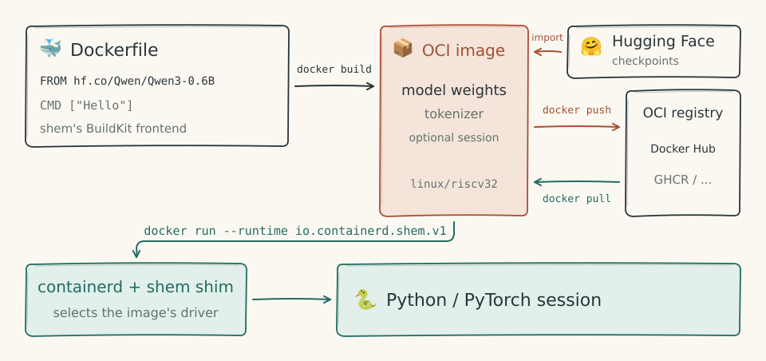

# containerd

`containerd-shim-shem-v1` ([`crates/containerd-shim-shem`](../crates/containerd-shim-shem/)) runs static RV32 Linux executables from OCI images on a shem vCPU. Docker and Kubernetes reach it through containerd. Model images use the same shim with a host-side session driver ([models.md](models.md#sessions-under-docker)).

## With Docker



```sh
cargo build --release -p containerd-shim-shem
sudo install target/release/containerd-shim-shem-v1 /usr/local/bin/

just cc -O2 -o hello guests/hello.c
printf 'FROM scratch\nCOPY hello /hello\nENTRYPOINT ["/hello"]\n' > Dockerfile
docker build --platform linux/riscv32 -t shem-hello .
docker run --rm --runtime io.containerd.shem.v1 --platform linux/riscv32 shem-hello one two
```

Docker 23 and later take a containerd shim's name as `--runtime` with no configuration, so installing the binary is the only setup. Add `--annotation dev.shem.vcpu=neural` to run the container inside the model, on a neural vCPU server listening at `/tmp/shem-neural.sock`, or at the socket `dev.shem.neural-socket` names.

`shem save IMAGE | docker load` puts a shem image into Docker, warm images included: their frozen state travels as an ordinary layer under `/.shem`, which the shim thaws instead of starting the entrypoint. The platform is `linux/riscv32`, which is what the image is: RV32 Linux programs. The runtime is what puts them on shem; without it, Docker tries to run them on the host CPU and fails with `exec format error`. `just docker-test` builds and runs an image this way and checks the output and the exit status, and CI runs it on every push.

## With containerd

```sh
cargo build --release -p containerd-shim-shem
sudo install target/release/containerd-shim-shem-v1 /usr/local/bin/

# an ordinary OCI image holding an RV32 program
just cc -O2 -o hello guests/hello.c
printf 'FROM scratch\nCOPY hello /hello\nENTRYPOINT ["/hello"]\n' | docker build -t shem-hello -f - .
docker save shem-hello | sudo ctr images import -

sudo ctr run --rm --runtime io.containerd.shem.v1 docker.io/library/shem-hello:latest demo /hello one two
```

containerd finds the shim by name on its `PATH`, so installing the binary is the only setup. As with any `ctr run`, a command after the container ID replaces the image's entrypoint, so it starts with the program. `just containerd-test` does all of the above and checks the output, and CI runs it on every push.

## How it works

containerd starts the shim and calls its task service over ttrpc. The shim:

1. **create**: mounts the image's root filesystem, which containerd's snapshotter prepared, into the bundle;
2. **start**: reads the bundle's `config.json` (the OCI runtime spec) for the process's arguments, environment and working directory, and the memory limit, which becomes the guest's memory (64 MiB if none is set), then runs the process on the selected vCPU, with its standard streams on containerd's FIFOs;
3. **wait**, **state**: report the exit status when the container's init exits; the shim also publishes the task's create, start, exit and delete events to containerd, which is how Docker learns that a container has exited;
4. **kill**: stops the guest at the next slice of instructions, with the status a shell reports for the signal;
5. **delete**: unmounts the root filesystem.

The part that turns a bundle into a container ([`bundle.rs`](../crates/containerd-shim-shem/src/bundle.rs)) is plain Rust with its own tests. The protocol around it ([`service.rs`](../crates/containerd-shim-shem/src/service.rs)) is Linux-only, as containerd is.

## Not yet

- `docker exec` and `docker commit` for program containers (model containers have both, see [models.md](models.md#sessions-under-docker)), checkpoints and resource statistics.
