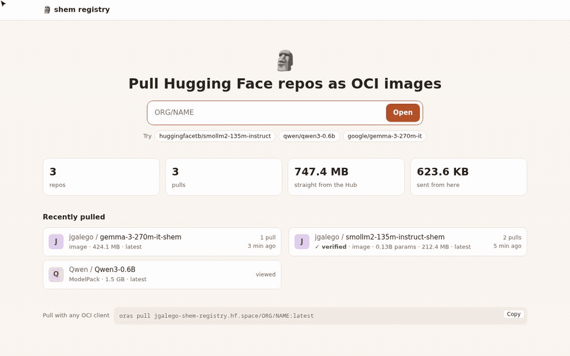
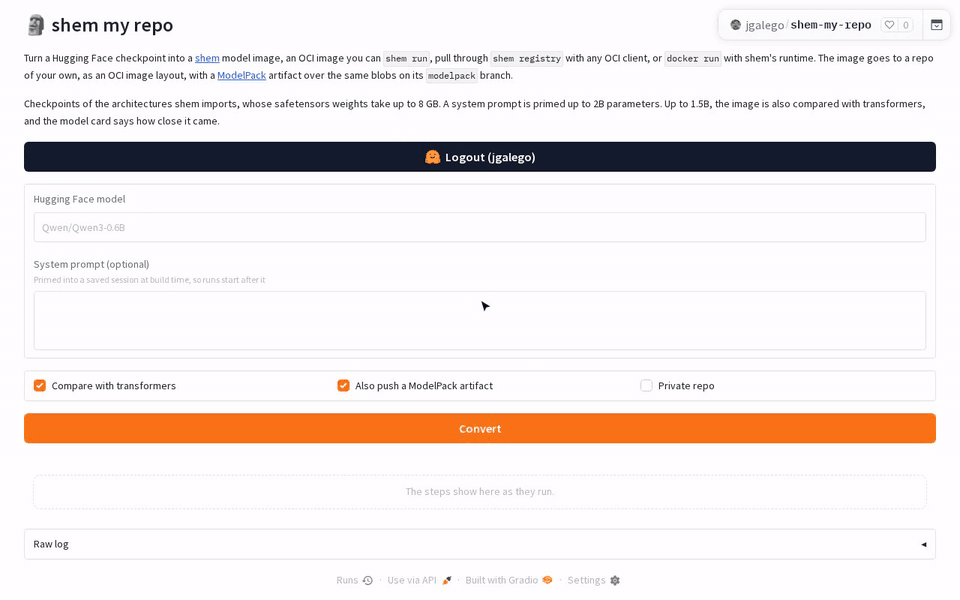

# Model images

A model image packages a language model's weights, tokenizer and optional session state in OCI layers. `shem run` starts or resumes a text-generation session; `shem push` and `shem pull` transfer the image through a registry.

```sh
shem build -t qwen3 examples/qwen3             # Qwen3-0.6B from Hugging Face, one layer per block
shem run qwen3 "What is a golem?"              # a session: the prompt in, the reply out
shem push qwen3 ghcr.io/your-user/qwen3:0.6b   # to a registry
shem run ghcr.io/your-user/qwen3:0.6b "Olá"    # elsewhere: pulled on first use, then run
```


Model imports and execution need [uv](https://docs.astral.sh/uv/); registry transfers need [ORAS](https://oras.land) and a registry login. For `docker build`, use shem's [BuildKit frontend](shemfile.md#with-docker-build), as in the [Qwen3 Dockerfile](../examples/qwen3/Dockerfile).

## Shemfile

```dockerfile
FROM hf.co/Qwen/Qwen3.5-0.8B
ENTRYPOINT ["shem:generate", "--max-tokens", "128"]
CMD ["Introduce yourself in one sentence."]
```

| Source | `FROM` example |
|---|---|
| Hugging Face checkpoint | `FROM hf.co/Qwen/Qwen3.5-0.8B` |
| Pinned revision | `FROM hf.co/ORG/NAME:REVISION` |
| Checkpoint directory in the build context | `FROM checkpoint/` |
| GGUF repository and quantization | `FROM hf.co/Qwen/Qwen3-0.6B-GGUF:Q8_0` |
| GGUF file in the build context | `FROM model.gguf` |

GGUF import uses transformers to dequantize into float32, from the `gguf` extra of shem-neural, which a release of shem fetches with its importer and the `shem-neural` image includes.

Model bases set `ENTRYPOINT ["shem:generate"]`. `ENTRYPOINT` and `CMD` keep their Docker meanings:

| Image | ENTRYPOINT | CMD | `shem run image …` |
|---|---|---|---|
| A program (`FROM scratch`) | A program in the image, run on the vCPU | Its default arguments | Replace the arguments |
| A model | A driver: `["shem:generate", "--max-tokens", "128"]` | The default prompt | Your prompt |

A `shem:` entrypoint selects a host-side driver, not a guest executable.

| `shem:generate` option | Meaning |
|---|---|
| `--max-tokens N` | Maximum reply length; default 256 |
| `--dtype bfloat16` | Compute in bfloat16, which halves the memory weights and sessions take and is faster on GPUs; default `float32` |
| `--system TEXT` | System prompt |
| `--system-file PATH` | Append a file from the image to the system prompt |
| `--stop TEXT` | End the reply at this text; useful for [base models](../examples/mamba/Shemfile) |
| `--tools DIR` | Offer programs in this directory as [tools](#compiled-layers-and-tools) |
| `--keep` | Keep a [Docker session](#sessions-under-docker) open after replying |
| `--serve [HOST:]PORT` | [Serve OpenAI's chat completions API](#serving-openais-api) instead of replying once |

Decoding is greedy and repeatable for the same model, session, prompt and device, which a [receipt](#receipts) lets anyone check.

## Sessions as layers

`WARM --until=prompt` primes a session at build time and freezes it into the image ([`examples/golem`](../examples/golem/Shemfile)):

```dockerfile
FROM hf.co/Qwen/Qwen3.5-0.8B
ENTRYPOINT ["shem:generate", "--system", "You are Shem, a golem made of clay and brought to life by a word."]
CMD ["Who are you?"]
WARM --until=prompt
```

The builder processes the conversation prefix before the user's prompt and saves each block's state: attention KV caches, convolution inputs and recurrent memory. `shem run` resumes there without processing the system prompt again.

To prime a model with a document, use `--system-file` ([handbook example](../examples/handbook/Shemfile)):

```dockerfile
FROM hf.co/allenai/OLMo-2-0425-1B-Instruct
COPY handbook.md /etc/handbook.md
ENTRYPOINT ["shem:generate", "--system", "Answer questions about shem from its handbook, below.", "--system-file", "/etc/handbook.md"]
WARM --until=prompt
```

Attention caches grow with the token count. Gated DeltaNet's convolution state and memory matrices are fixed-size. Qwen3.5 combines both block types, so its total session state still grows with its attention caches.

Sessions live under `/.shem`:

- `session.safetensors`: block state, keyed by block number and name.
- `session.json`: consumed tokens, precision and block-type versions.

A change to a block's saved-state semantics requires a version bump. If versions or precision differ, the runtime rebuilds state by replaying the saved tokens. [Compatibility tests](../neural/tests/test_sessions.py) load sessions saved by earlier releases.

### Sessions as artifacts

A session can be published separately from its model:

```sh
shem build -t golem examples/golem
shem build -t qwen3.5 examples/qwen3.5
shem push --state golem registry.example.com/team/golem:session
shem run --state registry.example.com/team/golem:session qwen3.5 "Who are you?"
```

`--state` reuses the image's state-layer blob. The artifact's `subject` is the model image without that layer, which is pushed alongside it. Use `oras discover` to list sessions referring to a model.

The config records the format (`shem.session/v1`), consumed tokens, precision, block versions and model fingerprint. The fingerprint hashes block definitions and tensor contents, independent of file layout. `shem run --state` accepts a registry reference or OCI layout directory and rejects mismatched weights, even if the model has the same shape.

The media type is `application/vnd.shem.session.v1+json`. Model state artifacts are also proposed in [modelpack/model-spec#239](https://github.com/modelpack/model-spec/issues/239); shem uses its own format.

## The model as files

The importer writes these files into `/model`:

| File | Contents |
|---|---|
| `shem.json` | Embedding, ordered blocks, head and tokenizer; block types, parameters and tensor names |
| `block-NNN-TYPE.safetensors` | One block's weights, with original tensor names and dtypes |
| `embed.safetensors`, `head.safetensors` | Embedding and output weights |
| `model.safetensors.index.json` | Tensor-to-file index |
| Checkpoint metadata | Configs, tokenizer, chat template, licence and notices |

Each weights file normally gets its own layer. Above 95 weights files, neighbouring blocks share layers to stay below overlay filesystem limits. Images based on the same model share weight blobs.

The directory remains a Hugging Face checkpoint: `AutoModelForCausalLM.from_pretrained("/model")` loads it. Manifest format `shem.model/v2` resolves tensor names through the index, so files can follow blocks or the checkpoint's original shards. The older `shem.model/v1` format is still supported.

Models consist of an embedding, ordered blocks and a head. A decoder layer is split into a token mixer and an MLP:

| Block type | What it does | Its state in a session |
|---|---|---|
| `attention` | Grouped-query attention; optional rotary scaling, biases, fused projections, QK norms, sliding windows, softcapping and output gates | Growing KV cache |
| `gated_deltanet` | Causal convolution and gated delta-rule matrix memory | Fixed-size convolution and memory state |
| `mamba` | Causal convolution and selective scan | Fixed-size convolution and scan state |
| `mlp` | SwiGLU or GeGLU; optional biases and fused projections | None |
| `moe` | Routed gated experts; optional shared expert | None |

Importers map each family's tensor layout, norms, rotary settings and scaling onto these block types. Supported families include Llama, Mistral, Qwen2 through Qwen3.5, Gemma 2 and 3, Phi-3 and Phi-4-mini, OLMo 2 and 3, SmolLM3, Granite, Mamba, Mixtral, Qwen-MoE, OLMoE and GraniteMoe.

Unsupported settings, such as dynamic NTK scaling or activations other than SiLU and GELU, fail at import. A new family needs a tensor reader; a new layer kind needs a registered type in [`blocks.py`](../neural/src/shem_neural/model/blocks.py). Neither requires an image-format change.

[`test_importers.py`](../neural/tests/test_importers.py) compares tiny random checkpoints with transformers without downloads. [`test_model.py`](../neural/tests/test_model.py) also checks real model configs, logits, templates and session resumes.

## Imported models

| Model | Blocks | Image | Verified |
|---|---|---|---|
| [Qwen/Qwen3-0.6B](https://huggingface.co/Qwen/Qwen3-0.6B) | 28 attention, 28 MLP | 59 layers, 892 MB | Logits within 1e-3 of transformers, and the same 24 greedy tokens |
| [Qwen/Qwen3.5-0.8B](https://huggingface.co/Qwen/Qwen3.5-0.8B) | 18 Gated DeltaNet, 6 attention with output gates and partial rotary positions, 24 MLP | 51 layers | The same, against transformers' Qwen3.5 |
| [HuggingFaceTB/SmolLM2-360M-Instruct](https://huggingface.co/HuggingFaceTB/SmolLM2-360M-Instruct) | 32 attention, 32 MLP | 67 layers | The same, against transformers' Llama |
| [Qwen/Qwen2.5-0.5B-Instruct](https://huggingface.co/Qwen/Qwen2.5-0.5B-Instruct) | 24 attention with query, key and value biases, 24 MLP | 51 layers | The same, against transformers' Qwen2 |
| [google/gemma-3-270m-it](https://huggingface.co/google/gemma-3-270m-it) | 18 attention (15 with sliding windows) with norms around them and on queries and keys, 18 GeGLU MLP | 39 layers | The same, against transformers' Gemma 3 |
| [allenai/OLMo-2-0425-1B-Instruct](https://huggingface.co/allenai/OLMo-2-0425-1B-Instruct) | 16 attention with norms after them and on all queries and keys, 16 MLP | 35 layers | The same, against transformers' OLMo 2 |
| [ibm-granite/granite-3.1-1b-a400m-instruct](https://huggingface.co/ibm-granite/granite-3.1-1b-a400m-instruct) | 24 attention, 24 mixtures of 32 stacked experts, 8 per token, with Granite's multipliers | 51 layers | The same, against transformers' GraniteMoe |
| [state-spaces/mamba-130m-hf](https://huggingface.co/state-spaces/mamba-130m-hf) | 24 Mamba | 27 layers | The same, against transformers' Mamba, with a template that runs a base model's text together |
| [Qwen/Qwen3-0.6B-GGUF](https://huggingface.co/Qwen/Qwen3-0.6B-GGUF) `:Q8_0` | As Qwen3-0.6B, dequantized | 59 layers | Logits within 1e-3 of transformers' own dequantization, and the same chat template |

Larger float32 comparisons use a [Hugging Face Job](https://huggingface.co/docs/huggingface_hub/guides/jobs) with 256 GB of memory (`just models-job`). Qwen3-30B-A3B alone needs 122 GB:

| Model | Blocks | Verified |
|---|---|---|
| [unsloth/Llama-3.2-1B-Instruct](https://huggingface.co/unsloth/Llama-3.2-1B-Instruct) | 16 attention with Llama 3's rotary scaling, 16 MLP | Logits within 1e-3 of transformers, and the same 24 greedy tokens |
| [mistralai/Mistral-7B-Instruct-v0.3](https://huggingface.co/mistralai/Mistral-7B-Instruct-v0.3) | 32 attention, 32 MLP | The same, against transformers' Mistral |
| [microsoft/Phi-3.5-mini-instruct](https://huggingface.co/microsoft/Phi-3.5-mini-instruct) | 32 attention with fused projections and longrope, 32 MLP | The same, against transformers' Phi-3 |
| [google/gemma-3-4b-it](https://huggingface.co/google/gemma-3-4b-it) | 34 attention (5 of 6 with sliding windows), 34 GeGLU MLP; the vision encoder left out | The same, against transformers' Gemma 3 vision-language model |
| [allenai/Olmo-3-7B-Instruct](https://huggingface.co/allenai/Olmo-3-7B-Instruct) | 32 attention (24 with sliding windows) with YaRN scaling, 32 MLP | The same, against transformers' OLMo 3 |
| [allenai/OLMoE-1B-7B-0125-Instruct](https://huggingface.co/allenai/OLMoE-1B-7B-0125-Instruct) | 16 attention, 16 mixtures of 64 experts, 8 per token | The same, against transformers' OLMoE |
| [Qwen/Qwen1.5-MoE-A2.7B-Chat](https://huggingface.co/Qwen/Qwen1.5-MoE-A2.7B-Chat) | 24 attention, 24 mixtures of 60 experts, 4 per token, and a gated shared expert | The same, against transformers' Qwen2-MoE |
| [Qwen/Qwen3-30B-A3B](https://huggingface.co/Qwen/Qwen3-30B-A3B) | 48 attention, 48 mixtures of 128 experts, 8 per token | The same, against transformers' Qwen3-MoE |
| [mistralai/Mixtral-8x7B-Instruct-v0.1](https://huggingface.co/mistralai/Mixtral-8x7B-Instruct-v0.1) | 32 attention, 32 mixtures of 8 experts, 2 per token | In bfloat16, as below: its 47 billion parameters take 188 GB in float32 |

Qwen3.5 and Gemma 3 4B imports are text-only: vision encoders are omitted, as is Qwen3.5's multi-token prediction layer.

Download-based tests in [`test_model.py`](../neural/tests/test_model.py) require `SHEM_MODEL_TESTS=1`. Add the larger-model flags as needed:

| Flag | Comparisons |
|---|---|
| `SHEM_MODEL_TESTS=1` | Small checkpoints: float32 logits, greedy tokens, templates and session resumes |
| `SHEM_LARGE_MODEL_TESTS=1` | Gemma-2-2B, Phi-4-mini, SmolLM3-3B and Granite-3.3-2B in bfloat16 |
| `SHEM_HUGE_MODEL_TESTS=1` | Larger checkpoints above, including Mixtral in bfloat16 |

```sh
SHEM_MODEL_TESTS=1 SHEM_LARGE_MODEL_TESTS=1 \
  uv run --project neural pytest neural/tests/test_model.py
```

Bfloat16 checks require next-token agreement at 90% or more of prompt positions and final-logit cosine similarity above 0.99. Gated models require access and a Hugging Face token; CI skips them, while `just models-job` forwards your token.

## ModelPack artifacts

[ModelPack](https://github.com/modelpack/model-spec) packages checkpoints as OCI artifacts. shem creates an *image twin* over the artifact's layers, adds `shem.json` and any missing index or chat template, and sets the artifact as its `subject`.

```sh
shem run registry.example.com/team/llama:modelpack "What is a golem?"
shem push registry.example.com/team/llama:modelpack registry.example.com/team/llama:shem
```

```dockerfile
FROM registry.example.com/team/llama:modelpack
ENTRYPOINT ["shem:generate", "--system", "You are a golem."]
WARM --until=prompt
```

`FROM`, `shem run` and `shem push` also accept artifact OCI layout directories. Twins are cached by artifact digest.

| Detail | Behavior |
|---|---|
| Tar layers | Shared unchanged with the artifact. Use `modctl build --raw=false` to produce them. |
| Raw layers | modctl's default; each file must be wrapped in a new tar blob. |
| Model path | Files land at `/`; `dev.shem.model=/`. The driver accepts `/model` or `/`. |
| Weights | Original checkpoint shards, not re-split by block. Requires safetensors and a supported family. |
| Labels | Model metadata becomes OCI labels; `org.opencontainers.image.base.digest` identifies the artifact. |
| Namespaces | Reads `vnd.cncf.model` / `org.cncf.model` and legacy `vnd.cnai.model` / `org.cnai.model`. |
| Docker builds | The frontend can use artifacts as bases, but BuildKit creates new layers. Build on a pushed twin to retain shared blobs. |

### Publishing an image as an artifact

```sh
shem push --modelpack qwen3 registry.example.com/team/qwen3:modelpack
shem push --modelpack --uncompressed qwen3 registry.example.com/team/qwen3:modelpack-tar
```

`--modelpack` publishes model-only layers with metadata from `shem.json`. The source image is pushed alongside it as the artifact's `subject`; `oras discover` lists the relationship.

- Default: shares the image's zstd blobs and preserves paths (`model/` for imported models). modctl 0.2 cannot extract these.
- `--uncompressed`: creates plain tar blobs with files at the root, for modctl extraction and runtimes that mount weights. ModelPack recommends uncompressed weights.
- Only layers containing model files alone are included. Tools, compiled layers and session state are excluded.

See the [round-trip example](../examples/modelpack/run.sh) and [compatibility tests](../crates/shem/tests/modelpack.rs).

## Images on Hugging Face

A Hugging Face repo can hold an image: its OCI image layout's files, `oci-layout`, `index.json` and `blobs/sha256/*`, at the repo's root. Each revision of the repo holds one image, so its branches, tags and commits are the image's tags, and `latest` is `main`.

```sh
shem push qwen3 hf.co/your-user/qwen3-shem                    # to main, creating the repo
shem push --modelpack qwen3 hf.co/your-user/qwen3-shem:modelpack
shem run hf.co/your-user/qwen3-shem "What is a golem?"        # pulled on first use
shem run hf.co/Qwen/Qwen3-0.6B "What is a golem?"             # no image there: imported
```

`shem pull` and `shem run` download the layout a repo holds at the revision given. A repo that holds none, but a checkpoint, is imported as a Shemfile of `FROM hf.co/ORG/NAME[:REVISION]` alone would build it, and kept in the store like a pulled image. A push uploads the blobs first, then the index, removing the blobs only earlier pushes had, so every commit's index finds its blobs. Pushes and private repos use your Hugging Face token (`HF_TOKEN`, or `hf auth login`).

### A registry over the Hub

`shem registry` serves these repos as a read-only OCI registry, for clients other than shem:

```sh
shem registry --port 5000 &
oras pull localhost:5000/your-user/qwen3-shem:latest
docker run --rm --runtime io.containerd.shem.v1 --platform linux/riscv32 localhost:5000/your-user/qwen3-shem "What is a golem?"
```

| Request | Answer |
|---|---|
| `GET /v2/ORG/NAME/manifests/TAG` | The first manifest the revision's `index.json` lists, or, in a repo without one, a ModelPack artifact of its files |
| `GET /v2/ORG/NAME/manifests/sha256:…` | That blob, from `main` or a revision already served |
| `GET /v2/ORG/NAME/blobs/sha256:…` | Up to 1 MB, the blob; larger, a redirect to where Hugging Face keeps it, so weights never pass through the registry |
| `GET /v2/ORG/NAME/tags/list` | `latest`, the other branches, and the tags |
| `GET /v2/files/ORG/NAME/…` | The same, for [an image of a checkpoint's files](#checkpoints-as-images-of-their-files); `safetensors/ORG/NAME` and other formats' names, for the files of one format of weights |
| `PUT`, `POST`, `PATCH`, `DELETE` | `405`: push with `shem push IMAGE hf.co/ORG/NAME` |

A repo that holds a checkpoint rather than an image is served as a ModelPack artifact made on request: a raw layer for each file but `.gitattributes`, at its path, typed as weights, documents, code or configs, and a model config from what the Hub says of the repo. A large file's layer is the file itself, named by the sha256 the Hub keeps for it, so it redirects to the Hub like any large blob; small files are downloaded once to learn their digests. The same commit makes the same artifact. `oras pull localhost:5000/huggingfacetb/smollm2-135m-instruct` downloads the repo's files, and `shem run localhost:5000/huggingfacetb/smollm2-135m-instruct` runs its image twin, which wraps each file in a tar of its own. The artifact is the whole repo, ONNX exports and all, where `shem run hf.co/…` downloads only what the import needs.

Requests to Hugging Face use this host's token, so whoever reaches the registry can pull the private repos it can read; it listens on `127.0.0.1` unless given `--host`. Hugging Face resolves repo names in any case, so a client that needs lowercase names, as Docker does, can pull `qwen/qwen3-0.6b-shem` for `Qwen/Qwen3-0.6B-shem`.

`shem registry --public` is for a registry anyone can reach. It never uses this host's token, only each client's, through the distribution spec's token flow: `/v2/` asks clients to log in, and `/token` gives them back the Hugging Face token they logged in with, once the Hub has confirmed it, or an anonymous one for public repos. A client asked for a gated or private repo without a token of its own is asked to log in. What the registry keeps of a repo, such as small blobs and the artifacts it made, is served only to clients the Hub lets read the repo, which it asks every 5 minutes for each token. The home page lists only repos that aren't private. Behind a proxy that terminates TLS, as a Space's does, the registry takes the scheme from `X-Forwarded-Proto`.

```sh
shem registry --public --host 0.0.0.0 --port 5000 &
echo "$HF_TOKEN" | docker login localhost:5000 -u hf --password-stdin   # only for gated and private repos
```

The [shem registry](https://huggingface.co/spaces/jgalego/shem-registry) Space runs `shem registry --public` over the whole Hub, at `jgalego-shem-registry.hf.space`:

```sh
docker pull --platform linux/riscv32 jgalego-shem-registry.hf.space/jgalego/smollm2-135m-instruct-shem
oras pull jgalego-shem-registry.hf.space/qwen/qwen3-0.6b
```



Outside `/v2/`, the registry serves pages for people. `/` has a search box, counts of the repos served, the pulls, and the bytes sent from the Hub, from the Hub as tars and from the registry, and the repos pulled since it started, last pulled first. `/ORG/NAME?tag=TAG` shows an image as a model page: badges for its comparison with transformers (from the repo's `comparison.json`), size, precision, licence and primed session; its system prompt, the model from its `shem.json`, its entrypoint and its layers; and beside them, the commands to use it with shem, oras or Docker, its digest, its source checkpoint and its tags. Open pages stay current: they ask `/live` whether what they show has changed, every 3 seconds for the home page and every 15 for a repo's, which asks the Hub for the revision's commit, and show the new version without reloading.

### Checkpoints as images of their files

Docker, containerd and Kubernetes take images, not artifacts: layers that are tars, listed for the host's platform. The registry serves every checkpoint's repo that way too, under `files/`, with the repo's files at the root of the filesystem:

```sh
docker pull localhost:5000/files/huggingfacetb/smollm2-135m             # every file of the repo
docker pull localhost:5000/safetensors/huggingfacetb/smollm2-135m-instruct   # without its ONNX exports
```

```dockerfile
FROM python:3.12-slim
COPY --from=localhost:5000/safetensors/huggingfacetb/smollm2-135m-instruct / /models/smollm2/
```

The image is listed for `linux/amd64` and `linux/arm64`, and has no entrypoint: it is files, for a Dockerfile to copy, or to mount as a [Kubernetes image volume](kubernetes.md#hugging-face-checkpoints-as-image-volumes) or with `docker run --mount type=image`. A mounted image is not copied into another: the weights stay on the Hub, and no registry keeps a copy of them.

| Name | Files |
|---|---|
| `files/ORG/NAME` | All of the repo's but `.gitattributes` |
| `safetensors/ORG/NAME` | Without those of other formats of weights, by the extensions in their names: no `model.onnx`, `model.onnx_data` or `pytorch_model.bin` |
| `gguf/`, `onnx/`, `bin/`, `pt/`, `pth/`, `ckpt/`, `h5/`, `msgpack/`, `tflite/` | The same, for that format |

- Files up to 1 MB, and those Git keeps itself, share the first layer, which the registry makes and serves.
- Each larger file is a layer of its own: an uncompressed tar of the file, which is the file between a 512-byte header and padding. Past 95 such files, neighbours share layers.
- A tar's digest is not the file's, which is the one the Hub knows. The registry reads each large file through once to learn it, so the first pull of a repo waits for that, and afterwards sends the layer as it reads the file from the Hub again. It keeps the digests in memory, by file, and stores no weights. A commit that changes other files reads none of them again.
- These layers pass through the registry, as nothing else does. `--files-limit 16G` refuses to make an image of a checkpoint with more weights than that left to read, which a registry anyone may reach should set. The artifact, at the repo's own name, is served whatever its size.
- Tags are the repo's revisions, as for the artifact. A repo that holds an image has no image of its files: pull it by its own name.
- A layer answers `Range` requests, so an interrupted pull resumes.

### Comparing an import with transformers

`shem-neural-verify` runs the check [`test_model.py`](../neural/tests/test_model.py) makes of each supported model on any import: the prompt's logits within 1e-3 of transformers' in float32, and the same greedy reply, one token at a time from the session's state. It needs transformers, which the `gguf` extra installs.

```sh
uv run --project neural shem-neural-verify Qwen/Qwen3-0.6B ./model --report comparison.json
```

### The Space

[`space/`](../space/README.md) is a Hugging Face Space that runs these steps for a checkpoint: it checks the architecture and size before downloading, builds the image with an optional system prompt primed by `WARM`, compares it with transformers, pushes it to `YOU/NAME-shem` with a ModelPack artifact on its `modelpack` branch, and writes a model card and `comparison.json`. Its [`convert.py`](../space/convert.py) runs the same steps from a terminal.

It runs at [jgalego/shem-my-repo](https://huggingface.co/spaces/jgalego/shem-my-repo). Log in with Hugging Face, name a checkpoint, and the image lands in your account.



## Sessions under Docker

Model sessions run in `shem-neural-server`, keyed by container ID. [Install the shim](containerd.md#with-docker), then start the server as root so it can read containerd-mounted root filesystems. The install script can run it as a systemd service, from the `shem-neural` release that matches shem:

```sh
curl -fsSL https://jgalego.github.io/shem/install.sh | SHEM_NEURAL_SERVICE=1 sh
```

To start it yourself, give `sudo` the full path of each program, since its `PATH` leaves out `~/.local/bin`, where uv installs itself and its tools:

```sh
sudo env SHEM_BIN="$(command -v shem)" "$(command -v uv)" tool run \
  --from "shem-neural==$(shem --version | cut -d' ' -f2)" \
  shem-neural-server --socket /tmp/shem-neural.sock
```

From a repository checkout, run the checkout's own:

```sh
uv sync --project neural
sudo env SHEM_BIN="$(command -v shem)" \
  neural/.venv/bin/shem-neural-server --socket /tmp/shem-neural.sock
```

The socket is accessible only to its owner and root. In another terminal:

```sh
shem save golem | docker load
docker run -d --name clay --runtime io.containerd.shem.v1 \
  --platform linux/riscv32 golem --keep "Who are you?"
docker exec clay shem:generate "What are you made of?"
docker commit clay golem:remembers
docker stop clay
docker rm clay
```

| Command | What it does |
|---|---|
| `docker run IMAGE "prompt"` | Answer once, then exit |
| `docker run -i IMAGE` | One conversation turn per input line; `-t` adds shim-side echo and backspace handling |
| `docker run -d --name c IMAGE --keep "prompt"` | Answer and keep the session open |
| `docker exec c shem:generate "follow-up"` | Continue the conversation |
| `docker commit c IMAGE2` | Pause, save tokens and block state into `/.shem`; `IMAGE2` resumes the conversation |
| `docker logs`, `stop`, `rm`, `ps` | Standard container operations |

The `docker run` rows omit the required `--runtime io.containerd.shem.v1 --platform linux/riscv32` flags for brevity.

## Serving OpenAI's API

`shem serve` serves a model image as OpenAI's chat completions API, for the clients and tools written for it:

```sh
shem serve golem --port 8000
curl -s localhost:8000/v1/chat/completions -H 'Content-Type: application/json' \
  -d '{"messages": [{"role": "user", "content": "Who are you?"}]}'
```

Under Docker, `--serve PORT` serves in the container's network, which `-p` publishes. The [model server](#sessions-under-docker) runs the model, as it does a session:

```sh
docker run -d -p 8000:8000 --runtime io.containerd.shem.v1 --platform linux/riscv32 golem --serve 8000
```

| Endpoint | Answers with |
|---|---|
| `POST /v1/chat/completions` | A reply to the messages; with `"stream": true`, server-sent events as it comes |
| `GET /v1/models` | The model, by the repository it came from |
| `GET /health` | 200 once the model is loaded |

- Replies are greedy, as the driver's are: sampling settings are accepted and ignored, and `n` must be 1. `max_tokens` and `stop` apply.
- The image's system prompt comes first unless a request gives its own, and a conversation that starts with the image's [primed session](#sessions-as-layers) goes on from it rather than reading it again.
- Requests take turns on the model. Messages are text; tools in requests, and images, are not understood yet.
- An image serves when it starts with `ENTRYPOINT ["shem:generate", "--serve", "8000"]` and `EXPOSE 8000`.

## Compiled layers and tools

A model image can include the [compiled RV32IM CPU](neural.md) and call programs on it ([tools example](../examples/tools/Shemfile)):

```dockerfile
FROM --platform=$BUILDPLATFORM alpine:3.22 AS tools
RUN apk add --no-cache zig
COPY mul.c .
RUN zig cc -target riscv32-linux-musl -mcpu=generic_rv32+m+a -static -O2 -o mul mul.c

FROM hf.co/Qwen/Qwen3-0.6B
COPY --from=shem:rv32im / /model/compiled/rv32im/
COPY --from=tools /mul /usr/local/bin/mul
COPY mul.json /usr/local/bin/mul.json
ENTRYPOINT ["shem:generate", "--tools", "/usr/local/bin", "--system", "Use the tools for arithmetic."]
CMD ["What is 123456789 times 987654321?"]
```

```
$ shem run tools
shem: ran mul 123456789 987654321 on the compiled RV32IM layer, 2,881 instructions
121932631112635269.
```

- `COPY --from=shem:rv32im` deterministically compiles CPU weights, machine config and model card. Both builders support it; releases publish the same [weights](https://huggingface.co/jgalego/shem-rv32im).
- `--tools DIR` exposes programs using the chat template's tool format (JSON or `<function=...>` tags). A sibling `NAME.json` defines the description and parameters, mapped to arguments in order; without it, the interface accepts `args` and `stdin`. See [`mul.json`](../examples/tools/mul.json).
- Calls run through `shem run --vcpu neural` with the image's weights and filesystem. Output returns as a tool reply; the CPU does not share the language model's residual stream.
- Use a model that calls tools. Qwen3-0.6B does in this example; Qwen3.5-0.8B attempts the multiplication itself and answers incorrectly.

## Receipts

`shem run --receipt` writes down what a model was asked and what it replied. `shem replay` checks it, on any machine that can run the image:

```
$ shem run --receipt receipt.json hf.co/jgalego/smollm2-135m-instruct-shem "Who are you?"
I am a Shem, a golem created by the word of the Lord.
shem: wrote a receipt of 18 tokens, the closest call by 0.0238 at token 14, to receipt.json
$ shem replay receipt.json
I am a Shem, a golem created by the word of the Lord.
shem: verified: the model chose the receipt's 18 tokens again
```

```json
{
 "format": "shem.receipt/v1",
 "image": "hf.co/jgalego/smollm2-135m-instruct-shem@sha256:5339b1f9226f33bdf3a557e21349dd7a4ad498f29dcebf1a9ef3601dcf9134fd",
 "prompt": "Who are you?",
 "reply": "I am a Shem, a golem created by the word of the Lord.",
 "tokens": [57, 744, 253, 334, 1676, 28, 253, 685, 12164, 2312, 411, 260, 2229, 282, 260, 5151, 30, 2],
 "margins": [1.468582, 3.081518, 0.482496, 0.352477, 4.440741, 2.73415, 3.147675, 0.110825, 4.741564, 0.202389, 2.020863, 0.145825, 0.144969, 0.023771, 0.029436, 0.159035, 0.954207, 0.645074],
 "runtime": {"shem": "0.3.0", "torch": "2.15.0+cpu", "device": "cpu", "machine": "x86_64", "precision": "float32", "blocks": {"attention": 1, "mlp": 1}}
}
```

- `image` is the reference the run was given and the image's manifest digest. The digest covers everything the reply depends on besides the prompt: the weights, the tokenizer, the system prompt, the primed session, the tools and the compiled CPU they run on. A run with `--state` adds `state`, the session's reference and digest. An OCI layout directory is recorded by its digest alone.
- `tokens` are the tokens the model chose, in order: each reply's and the token that ended it, tool calls included.
- `margins` say how firmly: each chosen token's logit less the runner-up's.
- `runtime` is what computed them: the neural package, torch, the device, the precision and the block versions.

`shem replay RECEIPT [IMAGE]` pulls the image the receipt names if the store lacks it, refuses an image whose digest is not the receipt's, replies to the receipt's prompt and compares each choice. `IMAGE` names the same image somewhere else, such as a mirror or a layout directory, and `--state REF` the same session.

| Status | Verdict | Meaning |
|---|---|---|
| 0 | `verified` | The model chose the receipt's tokens again |
| 1 | `mismatch` | The tokens differ where the choice was firm, or are not the reply the receipt gives: this image does not give that reply to this prompt |
| 3 | `undecided` | The tokens differ at a close call, which another device may make otherwise: replay on the receipt's device |
| 125 | | The receipt could not be replayed: no such image, or one with another digest |

Decoding repeats exactly on one device, while two devices round sums differently. A choice holds on any device whose logits are within half its margin of the receipt's. shem calls a choice close under a margin of 0.002 in float32, twice the tolerance [imports are held to](#comparing-an-import-with-transformers) against transformers, and 0.5 in bfloat16. These are rules of thumb, not bounds measured between devices. A receipt's closest call is printed when it is written.

A replay shows that this image gives this reply to this prompt. It does not show who ran it, or when: for that, sign the receipt, as with `cosign sign-blob`. To see what a change to the prompt does, run the changed prompt: nothing is sampled, so any difference in the reply comes from the change.

The [shem replay](https://huggingface.co/spaces/jgalego/shem-replay) Space checks a receipt in a browser: paste one, and it pulls the image, replays the prompt, and shows the verdict and each token marked by its margin. It then runs a changed prompt on the same image and shows how the reply differs, a word at a time. It takes receipts of images in public Hugging Face repos, up to 2.5 GB and 512 tokens, whose entrypoints run a model and nothing else: no tools and no server. Its steps are [`space/replay.py`](../space/replay.py), which runs from a terminal too:

```sh
uv run --project neural python space/replay.py receipt.json --prompt "Who am I?"
```

Receipts come from `shem run` only. Sessions under Docker and the API server write none yet. A receipt names its image by the reference the run was given, so once a repo is pushed to again, checking an older receipt takes the image it was made with, given to `shem replay RECEIPT IMAGE`.

## Running

The server defaults to `--device auto`; use `--device cpu` or `--device cuda` to select explicitly:

```sh
uv run --project neural shem-neural-server --socket /tmp/shem-neural.sock --device cuda
```

Recorded results from [`jobs/models_gpu.py`](../neural/jobs/models_gpu.py):

| Model | CPU tokens/s | L4 tokens/s |
|---|---|---|
| Qwen3-0.6B | 7.1 | 27.8 |
| Qwen3.5-0.8B | 5.6 | 31.2 |

`shem run` caches unpacked images at `$SHEM_HOME/rootfs/<digest>`. Computation uses float32 unless the entrypoint gives `--dtype bfloat16`, which halves the memory: Qwen3-30B-A3B's weights take 61 GB instead of 122 GB. Results are repeatable on the same device, not guaranteed bit-identical across devices. A session records the type it was computed in, and a model computing in another reads its tokens again.

## Next

- Compiled layers that read and write the residual stream directly.
- Batching sessions of the same model.
