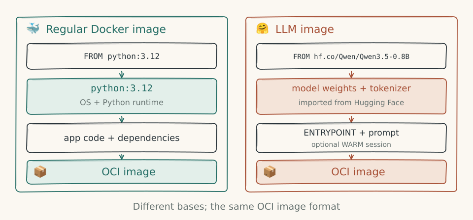

# Shemfile

A Shemfile uses Dockerfile syntax to build OCI images. `WARM` adds a build-time snapshot of a program, VM or model session.

```sh
just toolchain
shem build -t hello examples/hello            # build into the local image store
shem run hello                                # run it
shem images                                   # list the store
shem build -o hello.oci examples/hello        # or write an OCI image layout directory
shem push hello ghcr.io/your-user/hello:1.0   # push to an OCI registry
shem pull ghcr.io/your-user/hello:1.0         # pull into the store, and run it by that name
docker save hello | shem load                 # or load an image docker build made
shem rmi hello                                # remove it from the store
shem prune                                    # delete unpacked copies of images no longer stored
```

`shem images --format` takes `json`, or a Go template as `docker images --format` does, such as `'{{.Repository}}:{{.Tag}} {{.Size}}'`, after `table ` for aligned columns with headers. Its fields are `.Repository`, `.Tag`, `.ID`, `.Digest`, `.Kind` (`program`, `vm` or `model`), `.Size` and `.Bytes`, and its functions Docker's `json`, `upper`, `lower`, `title`, `truncate`, `pad`, `join`, `split` and `len`. `shem images -q` prints the IDs alone, which `shem rmi` takes as well as names: an ID tagged more than once needs `-f` to remove every tag.

## With docker build

To use shem's [BuildKit frontend](../frontend/), start the Dockerfile with its syntax directive:



```dockerfile
# syntax=ghcr.io/jgalego/shem/dockerfile:latest
FROM hf.co/Qwen/Qwen3.5-0.8B
ENTRYPOINT ["shem:generate", "--system", "You are Shem, a golem made of clay."]
CMD ["Who are you?"]
WARM --until=prompt
```

The published frontend and runtime images are built for `linux/amd64` and `linux/arm64`.

```sh
docker build --platform linux/riscv32 -t golem .
```

Run it with `docker run` through the [containerd shim](containerd.md#with-docker), or with `docker save golem | shem load` and `shem run golem`.

The frontend translates shem instructions into Docker build stages:

| Instruction | BuildKit behavior |
|---|---|
| `FROM hf.co/...` | Import in `shem-neural`, then copy weights into layers |
| ModelPack base or `COPY --from` source | Fetch the artifact and lay files out as its [image twin](models.md#modelpack-artifacts), without sharing the original blobs |
| `WARM --until=prompt` | Prime the model and copy session state into `/.shem` |
| `KERNEL` | Set `dev.shem.kernel` and `dev.shem.bootargs` labels |
| Other stages | Ordinary Docker stages on the build platform |

The frontend and runtime images support `linux/amd64` and `linux/arm64`; the resulting shem image uses `linux/riscv32`. `RUN` is not allowed in shem stages. Program and VM `WARM` require `shem build`, not `docker build`.

Build options:

| Option | Use |
|---|---|
| `--secret id=HF_TOKEN,env=HF_TOKEN` | Access gated Hugging Face models |
| `--secret id=docker_config,src=$HOME/.docker/config.json` | Authenticate to a registry |
| `--allow network.host` | Reach a registry on `localhost` |
| `--build-arg SHEM_NEURAL_IMAGE=IMAGE` | Select another runtime image |

Model downloads are cached between builds. Use `docker push` and `docker save` normally; `shem run` also accepts an extracted OCI layout from `docker save`.

## Examples

The [hello example](../examples/hello/Shemfile) cross-compiles in a Docker stage:

```dockerfile
FROM shem-toolchain AS build
WORKDIR /src
COPY hello.c .
RUN rv32-cc -O2 -o hello hello.c

FROM scratch
COPY --from=build /src/hello /bin/hello
ENTRYPOINT ["/bin/hello"]
CMD ["from", "a", "shem", "image"]
```

The [warm-shell example](../examples/warm-shell/Shemfile) freezes BusyBox before its first read:

```dockerfile
FROM shem-busybox AS busybox

FROM scratch
COPY --from=busybox / /
ENV PATH=/bin:/sbin:/usr/bin:/usr/sbin
ENTRYPOINT ["/bin/sh"]
WARM --until=syscall:read
```

Build it after creating `shem-busybox`:

```sh
just busybox-image
shem build -t warm-shell examples/warm-shell
```

```console
$ printf 'echo hello from a warm shell\nuname -m\n' | shem run warm-shell
hello from a warm shell
riscv32
```

`shem-toolchain` and `shem-busybox` are Docker images built from [`toolchain/Dockerfile`](../toolchain/Dockerfile) by `just toolchain` and `just busybox-image`.

## Stages

The last stage produces the image. It must use one of the `FROM` sources below. Other stages supply files through `COPY --from`; Docker stages build only when needed. Local paths are relative to the build context, and registry bases are pulled on first use.

## Instructions

| Instruction | In a shem stage |
|---|---|
| `FROM` | `scratch`, a Hugging Face model, checkpoint directory or GGUF file ([models.md](models.md)), or a shem image or a ModelPack artifact ([models.md](models.md#modelpack-artifacts)), in a registry or a layout directory |
| `COPY --from=shem:rv32im src dest` | Compiles and copies the RV32IM CPU for [model tools](models.md#compiled-layers-and-tools) |
| `COPY [--from=stage] src... dest` | As in Docker: a directory's contents are copied into `dest`; a file goes to `dest`, or into it when `dest` ends in `/` or there are several sources. Each `COPY` is one layer. Sources must stay inside the context. |
| `ENV`, `WORKDIR`, `ENTRYPOINT`, `CMD`, `ARG`, `LABEL` | As in Docker, including shell and exec forms, and `$NAME` and `${NAME}` substitution from `ARG` and `ENV` |
| `WARM` | Save build-time state; see below |
| `KERNEL path [command line]` | Select a kernel; see [VM images](#vm-images) |
| `RUN` | Not allowed. Build in a Docker stage and `COPY --from` it. |

Set resource limits with `shem run --mem` and `--max-steps`, not Shemfile instructions.

### WARM

```dockerfile
WARM --until=<condition> [--max-steps=<n>]
```

Runs the entrypoint at build time until the condition holds, then freezes the container into a state layer. `shem run` resumes from that point instead of starting the process again.

Conditions:

- `syscall:<name>` or `syscall:<number>`: stop before servicing the first matching call. At run time it receives live input. Names include `read`, `write`, `openat`, `execve`, `wait4` and `clock_nanosleep`.
- `steps:<n>`: stop once `n` instructions have retired.
- `ebreak`: stop when the guest executes `ebreak`, and resume after it. A program can use this to mark itself ready.

`--max-steps` fails the build if the condition is not reached in time (default: 4 billion instructions). A later `WARM` resumes from the previous one's state.

The guest runs with an empty stdin; its output goes to the build's stderr. The frozen container must be a single process with only stdin, stdout and stderr open: other open files live on the host and are not part of the snapshot yet.

A state layer holds:

1. `machine.state`: canonical [`MachineState`](../crates/shem/src/vcpu.rs), with pc, registers, retired instruction count and memory.
2. `container.json`: working directory, umask, memory map, signal state, LR/SC reservation, virtual clock and PRNG state.

Files the guest wrote during `WARM` become an ordinary filesystem layer, with whiteouts for deletions.

**Program and VM snapshots are built on the reference vCPU.** Their canonical state can resume on either vCPU. Model images instead use `WARM --until=prompt` to save a primed language-model session ([models.md](models.md#sessions-as-layers)).

A warm program image takes no arguments or environment at run time, and runs with the memory it was frozen with.

### VM images

```dockerfile
KERNEL <path> [command line]
```

`shem run` boots this kernel from the image filesystem in [VM mode](vm.md), with the console on stdio. The default command line is `earlycon=uart8250,mmio,0x10000000,1000000 console=ttyS0`; default memory is 64 MiB, configurable with `--mem`.

In a VM image, `WARM` boots the kernel at build time and freezes the machine. Its conditions are:

- `output:TEXT`: stop once the console's output ends with `TEXT`, such as a shell's prompt. Quote it to include spaces; in double quotes, JSON escapes such as `\n` work.
- `steps:<n>`: stop once `n` instructions have retired.

The state layer holds `machine.state` and `vm.json`, the host's half of the hardware (see [vm.md](vm.md#booted-snapshots)).

## Image format

A shem image is a standard [OCI image](https://github.com/opencontainers/image-spec) for `linux/riscv32`, stored as an [OCI layout](https://github.com/opencontainers/image-spec/blob/main/image-layout.md). Settings use these labels:

| Label | Value |
|---|---|
| `dev.shem.machine` | Machine type |
| `dev.shem.memory` | Warm image's memory size |
| `dev.shem.kernel`, `dev.shem.bootargs` | VM kernel path and command line |
| `dev.shem.model` | Model directory |

A warm image's last layer holds its state under `/.shem`.

Layouts in shem's earlier format, with these media types, can still be read:

| Media type | Contents |
|---|---|
| `application/vnd.shem.config.v1+json` | Entrypoint, cmd, env, workdir, labels, the machine (`rv32im`), a warm image's memory size, and a VM image's kernel and command line |
| `application/vnd.oci.image.layer.v1.tar+zstd` | Guest filesystem layers, in the standard format |
| `application/vnd.shem.state.v1.tar+zstd` | A `WARM` snapshot, always the last layer: a container's (`machine.state`, `container.json`) or a VM's (`machine.state`, `vm.json`) |

New layers use zstd-compressed tars. A booted Linux image is about 2 MB despite containing 64 MiB of RAM, mostly zeros. Uncompressed layers remain readable; inherited layers keep their original blobs and compression. A manifest can identify a related artifact through `subject`, as ModelPack twins do.

Images in the local store live under `$SHEM_HOME/images/<name>/<tag>`, by default `~/.local/share/shem/images`. Program and VM runs unpack a fresh filesystem and remove it afterwards. Model images [cache their unpacked filesystem](models.md#running).

Registry transfers use [ORAS](https://oras.land) and preserve manifest digests. Use `--plain-http` for a local registry without TLS.

## Reproducibility

Layers have sorted entries, timestamps of 0 and root ownership. Compression is deterministic; guest builds use a virtual clock, a seeded PRNG and empty stdin. With the same resolved base image, source files and build options, builds produce the same manifest digest, warm images included. Pin model revisions and Docker-stage inputs when repeatable builds are required.

## Copy-on-write

- **Filesystems.** Program and VM runs unpack all layers; there is no overlayfs backing.
- **Reference memory.** `fork` copies the guest's memory.
- **Neural memory.** The server shares 4 KiB pages between forks and restored snapshots, copying a page on its first write. The dense executor and GPU harness do not share pages ([neural.md](neural.md#density)).
