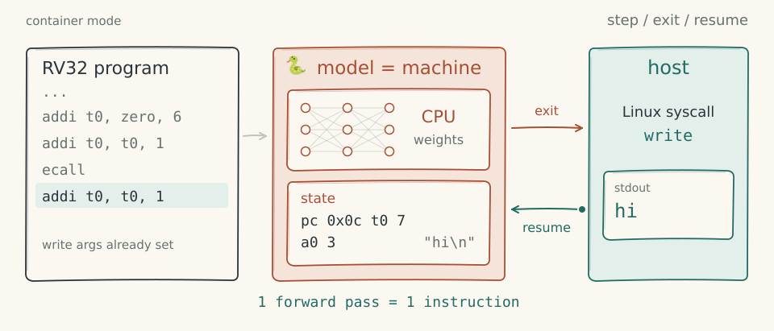

# shem-neural

The neural vCPU for [shem](https://github.com/JGalego/shem): an RV32IM CPU compiled into the weights of a network that runs one instruction per forward pass.



```sh
uv run pytest                                            # unit tests
uv run python -m shem_neural.server --socket /tmp/shem.sock   # serve vCPUs to the host
```

See the [neural vCPU documentation](https://github.com/JGalego/shem/blob/main/docs/neural.md) for how the network works and how the host talks to it.
